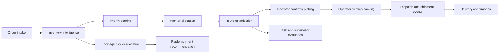

# Warehouse Intelligence AI

A full-stack warehouse operations platform with nine deterministic agents orchestrated by LangGraph. It connects order intake, priority scoring, inventory reservations, worker allocation, route optimization, physical fulfillment confirmation, shipment records and reporting.

**Live application:** https://multi-agent-warehouse.vercel.app

Choose **Open interactive demo** on the welcome screen. Demo data is synthetic and shared; demo operators can modify it. Registered accounts are read-only Analysts by default.

## Features

- Fifteen connected modules: overview, intelligence, orders, prioritization, picking, warehouse map, inventory, workers, agents, fulfillment, shipments, analytics, recommendations, activity and settings.
- 120 products and mapped bins, 55 customers, 220 initial orders, 16 workers and four zones; seed is safe to rerun.
- Order creation, deadline/shipping editing, cancellation with reservation release, search, filters and deadline sorting.
- Explainable weighted priority scoring and supervisor overrides with before/after audit evidence.
- Atomic stock reservations and worker conflict prevention using PostgreSQL row locks.
- Manhattan nearest-neighbor routing with 2-opt improvement, visual comparison, computed distances and estimated time.
- Quantity-verified picking/packing, explicit dispatch/shipment/delivery events and tracking references.
- Product management, stock adjustments, stock movement history, worker management and task reassignment.
- Real backend agent execution logs, failure recording and retries; rule-based risk and replenishment recommendations.
- Database-derived charts, KPIs, CSV export, notification alerts, responsive navigation and light/dark appearance.
- Argon2 password hashing, expiring JWT tokens, role checks, input validation and an audit trail.

## Stack and structure

```text
frontend/                   Next.js 16, React 19, TypeScript, Lucide, Recharts
  app/[[...slug]]/page.tsx   Operational workspace and module screens
  app/globals.css           Responsive design system
backend/                    Python 3.12+, FastAPI, SQLAlchemy, LangGraph
  app/database.py           Relational entities and sessions
  app/agents.py             Nine services and compiled LangGraph workflow
  app/optimization.py       Route algorithms and distance calculation
  app/main.py               Auth, REST APIs, analytics and transitions
  app/seed.py               Idempotent synthetic dataset
  tests/test_system.py      Integration and algorithm tests
  admin.py                  Secure administrator bootstrap
docs/                       Architecture, schema, API and deployment guides
vercel.json                 Next.js + FastAPI service routing
```

## Local setup

Requirements: Python 3.12+, Node.js 20.9+ and npm.

```powershell
python -m venv .venv
.venv\Scripts\Activate.ps1
python -m pip install -r backend/requirements.txt
Copy-Item .env.example .env
# Set environment variables in your shell; .env is a reference, not auto-loaded.
$env:JWT_SECRET_KEY = 'generate-a-long-random-secret-for-your-installation'
$env:DEMO_MODE = 'true'
cd backend
python seed.py
python -m uvicorn main:app --reload --port 8000
```

In a second terminal:

```powershell
cd frontend
npm ci
npm run dev
```

Open http://localhost:3000. The Next.js development rewrite sends `/api/*` to port 8000. API documentation: http://localhost:8000/api/docs.

SQLite defaults to `warehouse.db` in the backend working directory. For PostgreSQL set `DATABASE_URL` before starting or seeding. SQLAlchemy converts PostgreSQL URLs to the psycopg driver. Schema creation runs at startup. The current first release uses `create_all`; use versioned migrations before changing an existing production schema.

Create a real administrator without hardcoded credentials:

```powershell
cd backend
python admin.py admin@yourcompany.com "Warehouse Admin"
```

The script prompts for the password. New public registrations receive Analyst access. To run without shared demo operations, set `DEMO_MODE=false` and `ALLOW_REGISTRATION=false`, and provision real inventory/customer records before use.

## Testing

```powershell
cd backend
python -m pytest -q
cd ../frontend
npm run build
```

Executed validation: **12 backend tests passed** and **Next.js production build passed**, including TypeScript checking. Tests cover authentication, RBAC, seeding, order validation, shortages, LangGraph execution, reservations, worker conflicts, route arithmetic, quantity mismatches, physical stage transitions, shipping evidence, negative stock prevention, cancellation, CRUD, failed execution logs and CSV export.

## Workflow



The compiled graph executes all nine services, halting on service failure. The supervisor produces the final operational summary. Agents operate on database records, not fabricated LLM completions. Picking and shipping are never inferred from elapsed time.

## Deployment

See [deployment guide](docs/deployment.md). This repository deploys the frontend and Python API as two Vercel Services with one public origin. A free Neon PostgreSQL database is connected through Vercel Marketplace. No external AI key or paid API is needed. Do not commit environment files, database files or credentials.

## Current limits

- This is a functional demo release, not a certified production WMS. Demo operations share one dataset; there is no tenant isolation.
- Batch/Zone/Wave are route policy selections for individual orders; cross-order batch manifests, zone handoffs and scheduled wave dispatch are not implemented.
- Routes assume open rectilinear aisles, with no obstacle/traffic solver or OR-Tools integration.
- Risk prediction and recommendations use deterministic rules rather than trained models or generative AI.
- Analytics headline charts use the full dataset / last seven days; date filters apply to the report table and CSV export.
- No carrier integration, real-time push/WebSockets, password reset, MFA, email notifications, public role-administration screen or background scheduler.
- Replenishment requests create audited recommendations; stock changes only when an operator records a receipt/adjustment.
- Historical fulfilled demo records are synthetic events. They do not represent real shipments or measured worker history.
- Public demo requests are not rate-limited. Disable demo and registration before entering real business data; add rate limiting, migrations, monitoring, backup policy and concurrency/load testing before production use.
